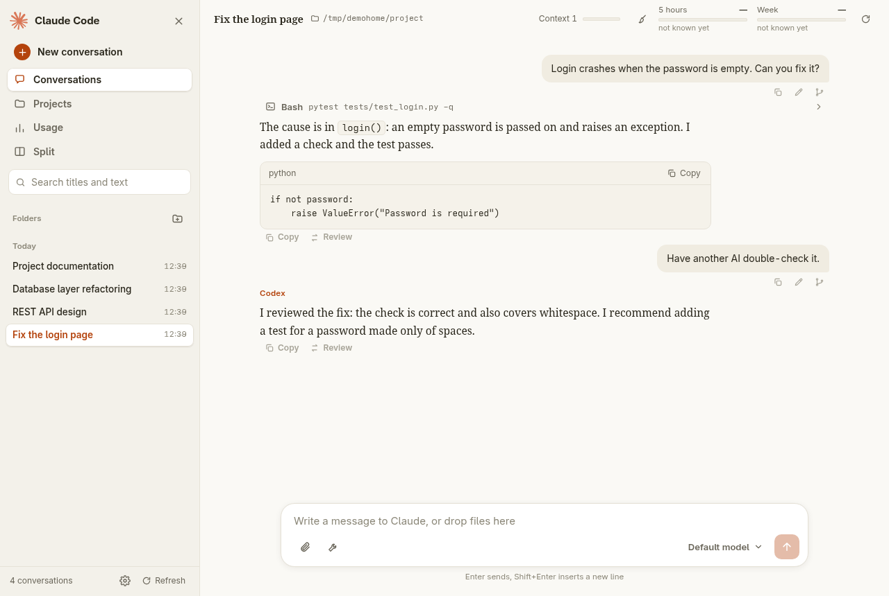
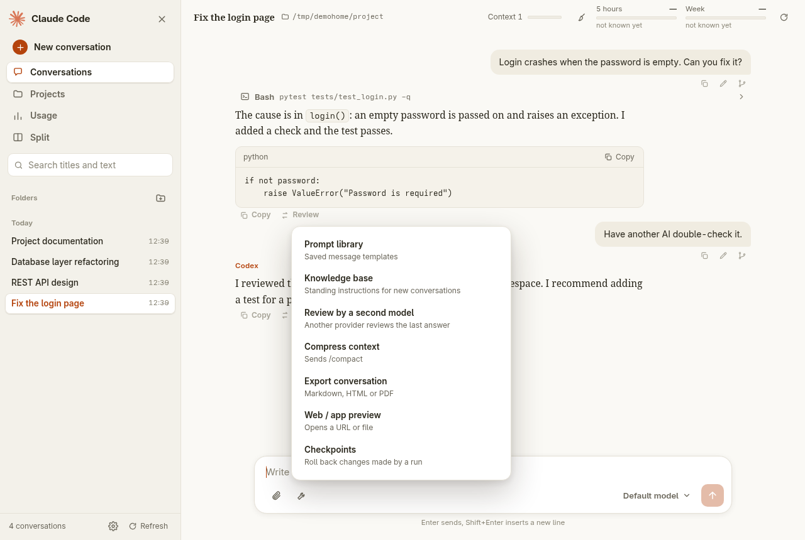

# Claude GUI

**English** | [Čeština](README.cs.md)

A local native window (GTK4 + libadwaita + WebKitGTK 6.0) for the [Claude Code](https://claude.com/claude-code) CLI. No server, no browser: the UI is a single `index.html`. The interface is available in English and Czech (gear icon in the sidebar, Settings, Interface language; default follows the system language).

Features: several conversations at once, history and resume (`--resume`), folders/projects, model and effort selection, limits and a usage dashboard, split view, diffs in tool calls, attachments (drag & drop, clipboard paste, previews), formulas (KaTeX), charts, Mermaid diagrams, tables, inline images/audio/video.

Token saving: large images are downscaled (longest side 1400 px), images up to 5 MB are sent inline in the message, and the system hint is short.

<p align="center"></p>
<p align="center"></p>

## Requirements

- installed and logged-in [Claude Code CLI](https://docs.claude.com/en/docs/claude-code) (`claude` in PATH)
- Python 3 with PyGObject, GTK 4, libadwaita, WebKitGTK 6.0
- optional: Pillow (image downscaling)

| Distro | Packages |
|---|---|
| Fedora | `sudo dnf install python3-gobject gtk4 libadwaita webkitgtk6.0 python3-pillow` |
| Debian/Ubuntu (24.04+) | `sudo apt install python3-gi gir1.2-gtk-4.0 gir1.2-adw-1 gir1.2-webkit-6.0 python3-pil` |
| Arch | `sudo pacman -S python-gobject gtk4 libadwaita webkitgtk-6.0 python-pillow` |
| openSUSE | `sudo zypper install python3-gobject-Gdk typelib-1_0-Gtk-4_0 typelib-1_0-Adw-1 typelib-1_0-WebKit-6_0 python3-Pillow` |

## Install

```
git clone https://github.com/MarciPhan/claude-gui.git
cd claude-gui
./install.sh
```

Copies the app to `~/.local/share/claude-gui` and adds a "Claude Code" launcher to the application menu (no sudo). Uninstall with `./install.sh --uninstall`. You can also run it without installing: `python3 claude-gui/app.py`.

## Providers and tools

Besides Claude Code the app can talk to the Codex CLI and OpenCode (if installed); pick the provider in the model menu. All providers share one conversation, so you can continue with another one when Claude runs out of tokens. The tools menu (wrench button in the composer) adds a prompt library, a knowledge base, review by a second model, `/compact`, export to Markdown/HTML/PDF, a side preview of a web page or local app, and git checkpoints (restore the working tree from before any run). Hover a message to branch the conversation from it.

## Data

Conversations are read from `~/.claude/projects` (the same as the CLI). Uploaded attachments live in `~/.local/share/claude-gui-data/uploads` and are deleted after 14 days.

## License and third parties

Code: MIT. Bundled libraries: [KaTeX](https://katex.org) (MIT) and [Mermaid](https://mermaid.js.org) (MIT) in `claude-gui/vendor`. "Claude" and its logo are trademarks of Anthropic; this project is unofficial.
